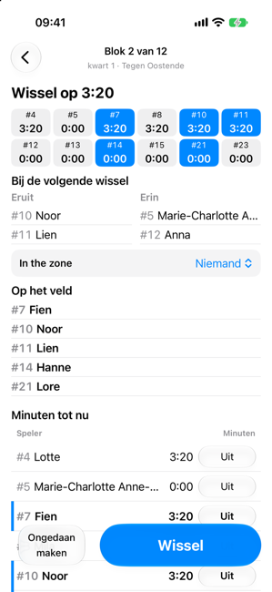
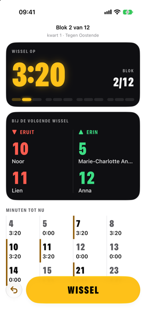
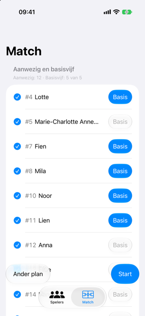
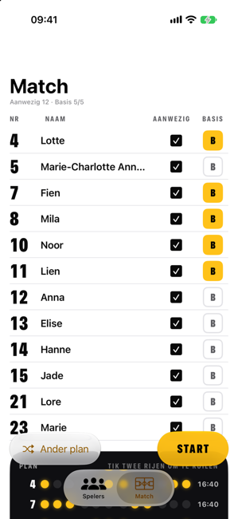
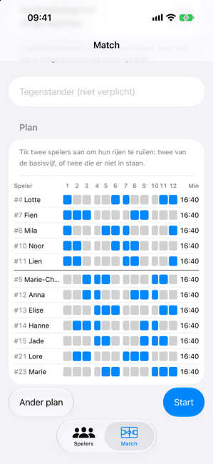
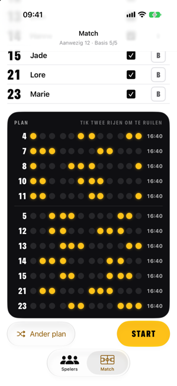
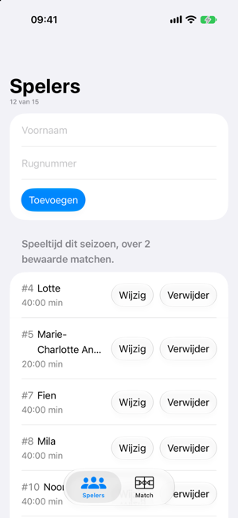
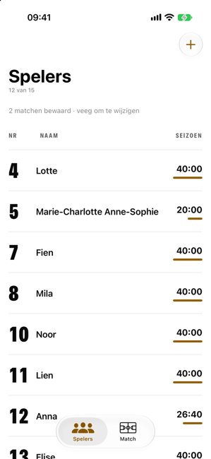

# Spike: a visual identity for the native app (the Wisselbord look)

**Question.** The owner asked on 2026-11-25 for "eye candy for the now-working app: a visual identity that could win an
Apple Design Award, while following Apple's Liquid Glass guidelines", shown as screenshots or quick proofs, not as
merged code. Which look, and what would it take?

**What was done.** A design agent read Apple's guidelines, restyled the working native app three ways as debug-only
proofs wired to the real Swift rules, and took screenshots of each beside today's app (`main` before #167) on the
simulator "iPhone 17 Pro (agent 2)" (iOS 27.2, Xcode 27.2), light and dark, at Dynamic Type Accessibility L and with
Increase Contrast on. Contrast was computed with the WCAG formula on the proofs' colour values and on pixels sampled from
the screenshots. Nothing was pushed or merged; the proofs live on a local branch only (`spike/redesign-poc`). The three
directions were **Parket** (the court as the canvas, about 2 weeks), **Wisselbord** (the referee's substitution board,
about 1 week) and **Teamkleur** (the team's kit colour, about 1.5–2 weeks). Only the chosen one is written up here;
screenshots are in [`2026-redesign/`](2026-redesign/), at half the device resolution.

**Short answer.** The owner chose **Wisselbord** on 2026-11-26, as a phase of its own (plan phase 6). Two gaps the
investigation found in today's app, glass buttons inside list rows and the on-court cells at 3.52:1 contrast, were
fixed on their own first (#167, PR #168).

> **Read this first.** What was **seen or measured** (screenshots, contrast ratios, the code) is kept apart from what is
> **judged** (why something matters, how a coach would react, the sizes). The judged parts are proposals for the owner
> to confirm, including how coaches would behave. Claims about devices or conditions that were not tested keep their
> own ⚠: all pictures are from the simulator. No real iPhone, no iPhone Duo, no sunlight, no sports hall.

## The owner's decisions (2026-11-26)

Given in the lead's thread on 2026-11-26, in answer to the redesign page; the plan's decisions #49–#52 and parked item
P3 cite this section.

- "redesign: Wisselbord. Why is there an extra screen though? Adapt the existing icon to the same color-scheme, don't
  make the icon you suggested. Make it a new phase / milestone"
- "we park the max-2-blocks-in-a-row idea and we're going with current rules for now. first need to use the app a
  couple of times in live setting."

The "extra screen" is the proofs' **Wissel moment** (`wisselbord-wissel-*.png`), a focus state of the live screen in
which the minutes are hidden and the substitution board grows. It was the design agent's own idea. The plan leaves it
out (decision #51, an agent's call for the owner to confirm in the plan PR).

## What Apple asks

Quoted from Apple's pages, fetched 2026-11-25 ([Sources](#sources)).

- **Glass is for controls and navigation, not content** (HIG › Materials): "Liquid Glass forms a distinct functional
  layer for controls and navigation elements — like tab bars and sidebars — that floats above the content layer."
  "Don't use Liquid Glass in the content layer." "Use Liquid Glass effects sparingly."
- **No glass on glass; let the system draw bars** (Adopting Liquid Glass): "avoid overcrowding or layering Liquid Glass
  elements on top of each other." "Reduce your use of custom backgrounds in controls and navigation elements."
- **Colour on glass only on the primary action's background** (HIG › Color): "To emphasize primary actions, apply color
  to the background rather than to symbols or text. […] Refrain from adding color to the background of multiple
  controls."
- **Every custom colour in light, dark and increased contrast** (HIG › Color): "If you define a custom color, make sure
  to supply light and dark variants, and an increased contrast option for each variant." "In bright surroundings,
  colors look darker and more muted."
- **More than colour alone** (HIG › Accessibility): "people who are color blind may have particular difficulty with
  pairings such as red-green and blue-orange. Offer visual indicators, like distinct shapes or icons".
- **Respect the settings** (Adopting Liquid Glass): "Ensure you test your app's custom elements, colors, and animations
  with different configurations of these settings" (Reduce Transparency, Reduce Motion).
- **Type** (HIG › Typography): SF comes in "several widths, including Condensed and Expanded"; "Using text styles with
  the system fonts also ensures support for Dynamic Type".
- **Motion** (HIG › Motion): "Make motion optional. […] avoid using it as the only way to communicate important
  information."
- **App icons** (HIG › App icons): "Avoid using black for your icon's background."

## The Wisselbord look

**Concept.** Built for a two-second glance pitch-side: a near-black board with huge compressed numerals, the coming
wissel shown like the referee's substitution board (red numbers with ▼ ERUIT, green numbers with ▲ ERIN), and one signal
colour, amber, for time. Everything that is not the decision steps back to ink on paper. It keeps today's screens and
their order; it changes the hierarchy, not the structure.

| | Light | Dark |
| --- | --- | --- |
| Page | white `#FFFFFF` | black `#000000` |
| Board (content, both modes) | near black `#0F0F12`, hairline edge | same, with a hairline so it reads on black |
| Signal (time, primary action) | LED amber `#FFC21A` on the board; `#8F5B00` as text tint on white | `#FFC21A` |
| Eruit (▼) / Erin (▲) on the board | `#FF5C4F` / `#3DDE85` | same |
| Text | ink `#0A0A0A`, muted `#5C5C60` | white, muted `#9A9AA0` |

- **Type:** SF Pro Compressed Black for every number (time, jersey numbers, plan rows), SF Pro Condensed Bold in tracked
  capitals for labels, SF Pro for names; all through text styles so Dynamic Type works.
- **Symbols:** `arrowtriangle.down.fill` / `arrowtriangle.up.fill` on the board, `checkmark`, `arrow.uturn.backward`,
  `shuffle`, `plus`.
- **Signature:** the board itself, and the blocks as an LED strip (played segments dim, the current one lit). The plan
  grid becomes a dot-matrix board (a lit dot per block played).
- **Liquid Glass:** navigation bar, toolbar `+`, tab bar, and the bottom Wissel and Start bars, where Wissel and Start
  are amber `.glassProminent` with black text (the only coloured glass). The boards are opaque content.

| Screen | Today | Wisselbord |
| --- | --- | --- |
| Live |  |  |
| Setup |  |  |
| Plan |  |  |
| Spelers |  |  |

Dark mode, Accessibility L and Increase Contrast pictures are in the folder (`*-dark.png`, `*-live-ax-light.png`,
`*-live-contrast-light.png`), as is the Wissel moment that the plan leaves out (`wisselbord-wissel-*.png`).

### Seen and measured

| Pair (WCAG formula on the proof's colours) | Ratio |
| --- | --- |
| Amber / red / green on the board | 11.76 / 6.26 / 10.83 |
| Black on amber (the Wissel label) | 12.89 |
| Amber text tint on white (light mode) | 5.73 |

- **Accessibility L** (`wisselbord-live-ax-light.png`): labels, names and the time grow; the board's jersey numbers keep
  a fixed size (a shortcut in the proof: they should scale too); a long name is cut ("Marie-Ch…").
- **Increase Contrast** (`wisselbord-live-contrast-light.png`): the amber bars on who is on court darken (`#6E4500`); the
  board is already 6–13:1.
- In and out always carry an arrow and a word, and sit left and right; the basisvijf carries a "B" key, not only a
  colour.
- Row actions are no longer glass: the proof used swipe actions on Spelers.
- ⚠ Not tried: Reduce Transparency, Reduce Motion and VoiceOver (simctl offers appearance and Increase Contrast only);
  the iPhone Duo (no wide layout was built); any real phone; sunlight or a sports hall.

### Judged

- It fits the job best of the three: the screen's one question pitch-side is who goes off, who comes on, and when, and
  the board answers it in numbers readable from arm's length, with the highest measured contrast of the three.
- Red and green are the board's convention but the pairing the HIG names as hard for colour-blind people; the arrows,
  the words and the left/right position carry the meaning too.
- ⚠ A black board in direct sun may show reflections more than a white page (not tried).
- The amber time looks like a running clock, but the app has no game clock (ADR-001): "3:20" is the scoreboard time at
  which to change. A plain, non-glowing treatment with the "Wissel op" label keeps it from reading as a countdown.
- Swipe actions on Spelers are less discoverable than buttons, so a visible way to edit stays.
- Size: about a week of builder work (judged), because it stays close to today's structure.

### What it would take (the investigation's list, after the owner's decisions)

| # | Work | Size (judged) |
| --- | --- | --- |
| F2 | Design tokens: colour sets in the asset catalog with light, dark and increased-contrast values, plus type helpers (text style + width), replacing literal colours | S |
| W1 | The time board with the LED strip, scaled with Dynamic Type | S |
| W2 | The substitution board (▼ Eruit / ▲ Erin) and the In the zone and Extra minuten controls under it, numeric-text transitions and a haptic on Wissel, with Reduce Motion fallbacks | M |
| W3 | The minutes as a stat sheet with Uit / Terug (a menu per cell or a sheet) | M |
| W4 | The setup table (present check, "B" key) and the dot-matrix plan with swaps | M |
| W5 | Spelers: big numbers, season bars, a visible Wijzig path beside any swipe action | S |
| W6 | The wide layout for the Duo's inner screen (board left, sheet right) | S |
| F4 | Accessibility pass: AX layouts, VoiceOver labels for drawn elements, Reduce Motion and Reduce Transparency checked, a contrast test for the tokens | M |
| F5 | The app icon: today's icon (#118) recoloured to the board's palette, no new drawing | S |

Not carried: F1 and F3 (done in #167); the Wissel moment focus state (decision #51); a Live Activity / Dynamic Island
board (W7, out of scope under plan decision #32 and ADR-001); the proofs' own app-icon idea (declined by the owner).

### New words on screen

Plan decision #39 reuses the web app's copy. The proofs used today's words for most labels ("Wissel op", "Bij de
volgende wissel", "Eruit", "Erin", "Minuten tot nu", "Ander plan", "Start", "Basis", "Aanwezig") and added a few of
their own. The plan keeps today's sentences and allows only short column labels as new copy (decision #52):

| In the proofs | In the build |
| --- | --- |
| "Nr", "Naam", "Seizoen" (column headers) | kept: short labels for the new tables |
| "BLOK 2/12" on the board | today's "Blok 2 van 12" |
| "Aanwezig 12 · Basis 5/5" | today's "Aanwezig: 12 · Basisvijf: 5 van 5" |
| "Tik twee rijen om te ruilen" | today's "Tik twee spelers aan om hun rijen te ruilen: …" |
| "In the zone? Houd #10 erop" | today's "In the zone" control and its wording |
| "veeg om te wijzigen", "12 van 15" (Spelers) | dropped; the visible Wijzig path needs no hint |

## Sources

- Apple HIG, Materials: https://developer.apple.com/design/human-interface-guidelines/materials
- Apple HIG, Color: https://developer.apple.com/design/human-interface-guidelines/color
- Apple HIG, Typography: https://developer.apple.com/design/human-interface-guidelines/typography
- Apple HIG, Accessibility: https://developer.apple.com/design/human-interface-guidelines/accessibility
- Apple HIG, Motion: https://developer.apple.com/design/human-interface-guidelines/motion
- Apple HIG, App icons: https://developer.apple.com/design/human-interface-guidelines/app-icons
- Apple, Adopting Liquid Glass: https://developer.apple.com/documentation/technologyoverviews/adopting-liquid-glass
- Apple Design Awards: https://developer.apple.com/design/awards/
- In the repo: `docs/screens/2026-phase-3.md`, `docs/spikes/2026-ui-review.md`, ADR-001 (no game clock), plan
  decisions #32, #37, #39, #46.
